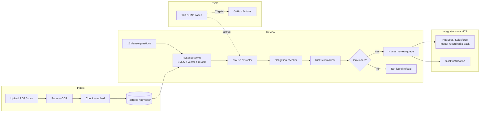

# Contract Compliance Reviewer

**An eval-first, citation-only contract review system, built as a full customer engagement for a fictional mid-size law firm.**

A lawyer uploads a messy contract. The system answers fifteen questions a partner would ask
("Which law governs this?", "Can they walk away without cause?", "Is liability capped?")
and for every answer it either points at the exact text in the document or says
**"not found"**. Nothing gets marked final without a human reviewer signing off.

> Status: **Phase 3 of 4 - integrated and packaged.** Three MCP servers, HubSpot and
> Slack write-back through a durable outbox, sub-agents for obligations and risk,
> Docker Compose and a Helm chart, and an offline switch. Every number below is produced
> by `uv run ccr-eval` and committed; nothing is hand-typed.


### Progression so far

| Version | Presence accuracy | Span recall | Citation precision | False refusal | Hallucinated presence |
|---|---:|---:|---:|---:|---:|
| Keyword baseline (Phase 1) | 62% | 35% | 17% | 9% | **61%** |
| Retrieval, BM25 only | 82% | 57% | 36% | 11% | 24% |
| **Retrieval, hybrid (current)** | **82%** | **62%** | **38%** | **9%** | **24%** |
| Retrieval + LLM extraction | pending API key | | | | |

Citation precision is the known weak spot: retrieval cites whole paragraphs, the
annotated clause is one or two sentences inside them. That is the LLM extraction step's
job ([ADR-0002](docs/adr/0002-retrieval-architecture.md) explains the tradeoff).

Full per-clause table: [docs/scorecard.md](docs/scorecard.md).

### The review queue


Every finding is either cited to a page and character range or marked "not found".
Nothing is final until a named person approves or rejects it; the decision, name, and
note are stored and exported with the review.

---

## Why this project exists

Most "AI contract review" demos fail in the same three ways when a real firm tries them:
they invent clauses that are not there, they cite the wrong paragraph, and nobody can
say how often either happens. This project is built around measuring those failures
before writing the system that has to avoid them.

Concretely:

| The firm's question | How this repo answers it |
|---|---|
| "How often does it make things up?" | `hallucinated_presence_rate` on 60+ clauses that are genuinely absent |
| "When it cites something, is that real?" | `citation_precision`: every cited span must overlap annotated evidence |
| "Does it find what a lawyer would find?" | `span_recall` against the CUAD expert annotations |
| "Will it get worse after an update?" | CI regression gate blocks merges below the committed floor |
| "Can we run it inside our own network?" | Planned: air-gapped mode swaps the model with one flag (Phase 3) |

## Architecture (target state)



Every box above exists. LLM extraction and the LLM paths of the sub-agents are wired
and tested against fake clients; they activate when `ANTHROPIC_API_KEY` is set and are
unscored until then.

### What happens when things break

The integration layer is built around one rule: a lawyer's Approve never fails because
HubSpot or Slack is slow. Writes go into a transactional outbox and a worker delivers
them with backoff, jitter, Retry-After handling, and idempotency keys that survive a
crash mid-write. The full failure-mode table, one row per way each system can fail, is in
[docs/integrations.md](docs/integrations.md). The reasoning is in
[ADR-0003](docs/adr/0003-outbox-and-mcp-boundaries.md).

### For agents: MCP servers and a packaged skill

| Server | Tools | Who gets it |
|---|---|---|
| `ccr-mcp-documents` | list, review, search, get findings, record a named decision | Associates (read), partners (decide) |
| `ccr-mcp-crm` | look up matter, queue write-back, reconcile | Partners, integration jobs |
| `ccr-mcp-notify` | post to the review channel | Partners |

Roles per tool are declared in [`customers/harlow-pryce.yaml`](customers/harlow-pryce.yaml).
A denied call returns `status: denied` with the reason instead of crashing the agent.
The [`contract-review` skill](skills/contract-review/SKILL.md) tells an agent when to use
these tools, the hard rules (cite or refuse, proposals are not final), and the eval hooks
that gate any prompt change.

### Second customer is a YAML file

Everything customer-specific (clause list, engine, integrations, roles, ROI inputs) lives
in `customers/<id>.yaml`. The code does not know which customer it serves. Phase 4 adds a
healthcare policy reviewer as a second file.

## The eval set is the spec

120 cases across 8 real contracts and 15 clause types, derived from
[CUAD](https://www.atticusprojectai.org/cuad) (expert-annotated, CC-BY 4.0).
About half are **absent** cases: the clause is not in the contract and the correct answer
is a refusal. Those are the cases that distinguish a useful tool from a confident liar.

```yaml
# evals/cases/<contract>.yaml (one case shown)
- id: biopurecorp-agency-agreement__governing_law
  clause_type: governing_law
  question: Which jurisdiction's law governs this contract?
  expected:
    present: true
    spans:
      - start: 33184
        end: 33448
        text: This Agreement and all related business transactions will be governed by the laws of the C...
  source: {dataset: cuad, id: "BIOPURECORP_06_30_1999-EX-10.13-AGENCY AGREEMENT__Governing Law"}
  tags: [present]
```

Every span is verified against the contract text on load. A case that drifts from its
document fails the test suite.

### Metrics

| Metric | Question it answers | Direction |
|---|---|---|
| `presence_accuracy` | Did it correctly say whether the clause exists? | higher |
| `span_recall` | When present, did it find the actual text (>= 50% coverage)? | higher |
| `citation_precision` | Of everything it cited, how much overlapped real evidence? | higher |
| `false_refusal_rate` | How often did it say "not found" when the clause was there? | lower |
| `hallucinated_presence_rate` | How often did it claim a clause that does not exist? | lower |

## Run it

```bash
uv sync --extra dev
uv run pytest                            # unit, app, and eval-set integrity tests
uv run ccr-serve                         # review queue at http://127.0.0.1:8000
uv run ccr-eval                          # score the production reviewer, regenerate chart + table
uv run ccr-eval --reviewer keyword       # or: retrieval-bm25, retrieval-dense, retrieval-hybrid, llm
uv run ccr-eval --gate                   # what CI runs: fail on regression vs evals/gate.json
uv run ccr-build-evals                   # rebuild the eval set from CUAD (deterministic seed)
uv run python -m scripts.calibrate_thresholds   # the sweep behind ADR-0002
```

```bash
uv run ccr-sync                          # drain the integration outbox once, then reconcile
uv run ccr-mcp-documents                 # MCP server over stdio (also: ccr-mcp-crm, ccr-mcp-notify)
CCR_OFFLINE=1 uv run ccr-serve           # air-gapped: local engine, all outbound calls refused

cp .env.example .env && docker compose up --build     # app + outbox worker + Postgres
helm install ccr deploy/helm/ccr --set database.url=postgresql+psycopg://...   # customer VPC
```

Requires Python 3.11+ and [uv](https://docs.astral.sh/uv/). The embedding model
(~130 MB) downloads once and is cached; the Docker image bakes it in so containers start
offline. `--reviewer llm` needs `ANTHROPIC_API_KEY`. `CCR_CUSTOMER` selects the customer
YAML; `CCR_REVIEWER` overrides the engine; `DATABASE_URL` points at Postgres instead of
the default SQLite. See [`.env.example`](.env.example) for every variable.

> Docker Compose and the Helm chart are written and reviewed but not yet exercised on a
> cluster; that is the first item in Phase 4 and will get its own post-mortem if it breaks.

## Repository map

```
src/reviewer/        the system under test
  interfaces.py        Finding / Span / Reviewer protocol - the contract every version honours
  clauses.py           the 15 clause types, their plain-English questions, and why each matters
  baselines.py         keyword baseline (the floor), always-absent (sanity), and the reviewer registry
  ingest.py            PDF / DOCX / TXT to text + page map; detects scans with no text layer
  chunking.py          paragraph-aware chunks that keep character offsets
  retrieval.py         BM25, local dense (bge-small via fastembed), and RRF hybrid
  pipeline.py          RetrievalReviewer (offline) and LLMReviewer (grounded quotes only)
  agents.py            sub-agents: clause extractor, obligation checker, risk summarizer
  config.py            customer YAML loader, offline switch, secrets accessors
  app/                 FastAPI review queue: upload, propose, approve/reject, export
  integrations/        http client (retry/jitter/Retry-After/offline), outbox, HubSpot, Slack, sync
  mcp/                 three MCP servers with per-tool role checks and graceful degradation
customers/           one YAML per customer; the code does not know which one it serves
skills/contract-review/  packaged skill: when to use, hard rules, tools, procedure, eval hooks
deploy/helm/ccr/     Helm chart: app, sync worker, secrets, egress NetworkPolicy, ingress
Dockerfile, docker-compose.yml, .env.example
evals/
  schema.py            eval case format, loader, span verification
  scoring.py           the five metrics
  report.py            terminal table, Markdown table, SVG chart (no matplotlib)
  run.py               CLI + CI regression gate
  cases/*.yaml         120 cases, one file per contract
  contracts/*.txt      the 8 contract texts (CUAD, CC-BY 4.0)
  gate.json            the regression floor CI enforces
engagement/          what a real engagement produces besides code
  discovery-memo.md    who the customer is, what they do today, what "better" means
  scope.md             what is in, what is out, what "done" means, and the ROI framing
docs/
  adr/                 architecture decision records (options considered, not just the winner)
  scorecard.md         current numbers, regenerated by ccr-eval
  img/scorecard.svg    the chart above
```

## Roadmap

| Phase | Deliverable | Proof |
|---|---|---|
| 1 (done) | Eval set, harness, CI gate, interfaces, engagement docs | Baseline row in the progression table |
| 2 (done) | Ingest, hybrid retrieval, refusal, human-review queue, LLM extraction (behind key) | Scorecard climbed 62% to 82% presence, 61% to 24% hallucination; ADR-0002 |
| 3 (now) | MCP servers, outbox + HubSpot + Slack, sub-agents, packaged skill, customer YAML, Compose + Helm, offline switch | 48 tests incl. fakes for every failure mode; docs/integrations.md; ADR-0003 |
| 4 | Deploy for real, post-mortem, runbook, 3-min demo, second customer (healthcare policy reviewer via config), OIDC | Same codebase, different YAML, different domain |

## Engagement documents

- [Discovery memo](engagement/discovery-memo.md): the customer, their current process, and where the hours go.
- [Scope](engagement/scope.md): what ships, what does not, and how success is measured.
- [Architecture decisions](docs/adr/): every significant choice with the alternatives that lost.
- [Integrations and failure modes](docs/integrations.md): one row per way each system can break.

## Data and licensing

Contract texts and clause annotations come from the
[Contract Understanding Atticus Dataset (CUAD)](https://github.com/TheAtticusProject/cuad),
Hendrycks et al., 2021, licensed CC-BY 4.0. See [ATTRIBUTION.md](ATTRIBUTION.md).
Code is MIT.
